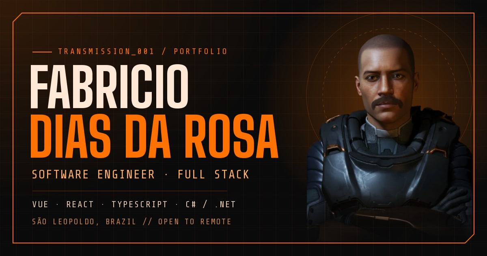

# Fabricio Dias da Rosa · Portfolio

Personal portfolio of a full stack software engineer (Vue 3, TypeScript, C# / .NET), with an Elite Dangerous inspired HUD look.

**Live:** https://fabriciodr01.github.io/portifolio/



## Highlights

- Full-screen sections with scroll snapping on desktop, free scrolling on phones and short windows.
- Federal Corvette hologram in react-three-fiber with a custom fresnel and scanline shader, loaded only when it is about to appear.
- About dossier that types itself out, keyboard-navigable experience log, and projects filterable by technology.
- Theme tokens and a type scale in Tailwind CSS v4, AA contrast for every text role, and `prefers-reduced-motion` respected everywhere.
- SEO and link previews: Open Graph image, JSON-LD profile, sitemap.

## Stack

- React + TypeScript
- Vite
- Tailwind CSS v4
- Motion
- three.js + react-three-fiber
- simple-icons

## Running locally

```bash
npm install
npm run dev
```

Production build: `npm run build` (output in `dist/`).

## Deploy

Every push to `master` (or `main`) builds and publishes the site to GitHub Pages via [`.github/workflows/deploy.yml`](.github/workflows/deploy.yml).

## Contact

- GitHub: [Fabriciodr01](https://github.com/Fabriciodr01)
- LinkedIn: [fabriciodr01](https://www.linkedin.com/in/fabriciodr01)

## Credits

- ["Federal Corvette"](https://sketchfab.com/3d-models/federal-corvette-53be2398eed14a6ab9a9195de98ff134) by [Andreas Engevold](https://andreas93609.artstation.com/projects/J9WyJv), licensed under [CC BY 4.0](https://creativecommons.org/licenses/by/4.0/). Modified: simplified and converted to an edge/hull hologram with [`scripts/obj-to-edges.mjs`](scripts/obj-to-edges.mjs).
- Technology icons from [simple-icons](https://simpleicons.org/) (CC0).
- Ship specifications from [elitedangerous.com](https://www.elitedangerous.com/store/ships/federal-corvette) and [EDCD/coriolis-data](https://github.com/EDCD/coriolis-data).
- Elite Dangerous is a trademark of Frontier Developments plc. This is a fan-made personal site, not affiliated with Frontier.
